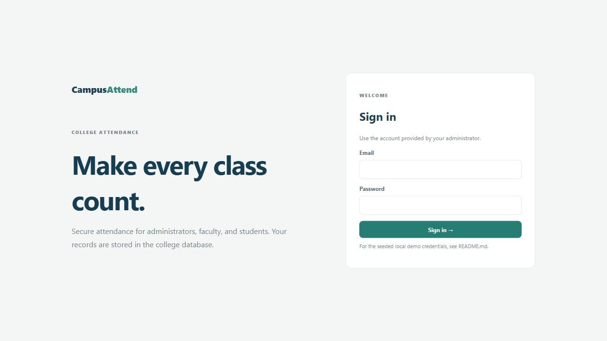
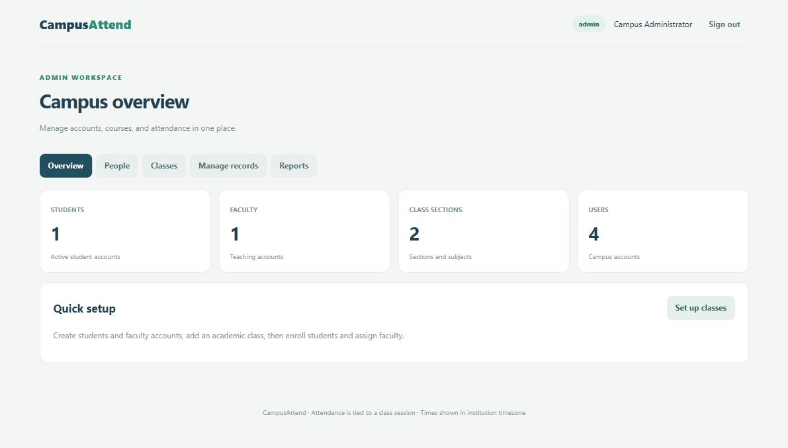
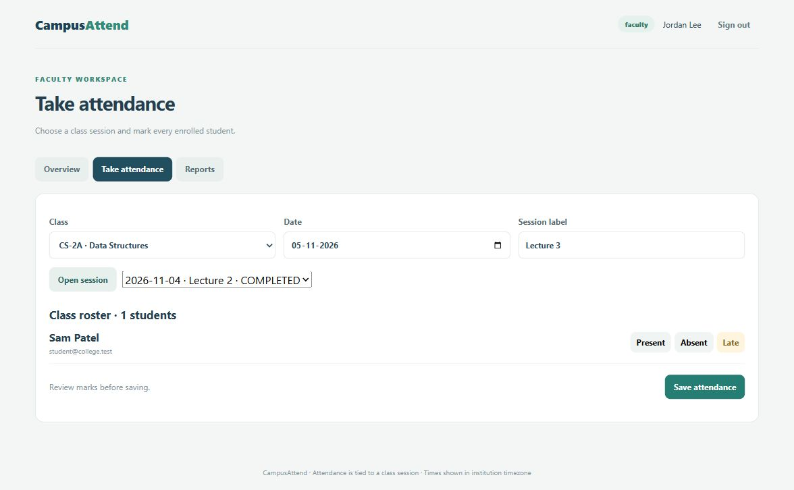
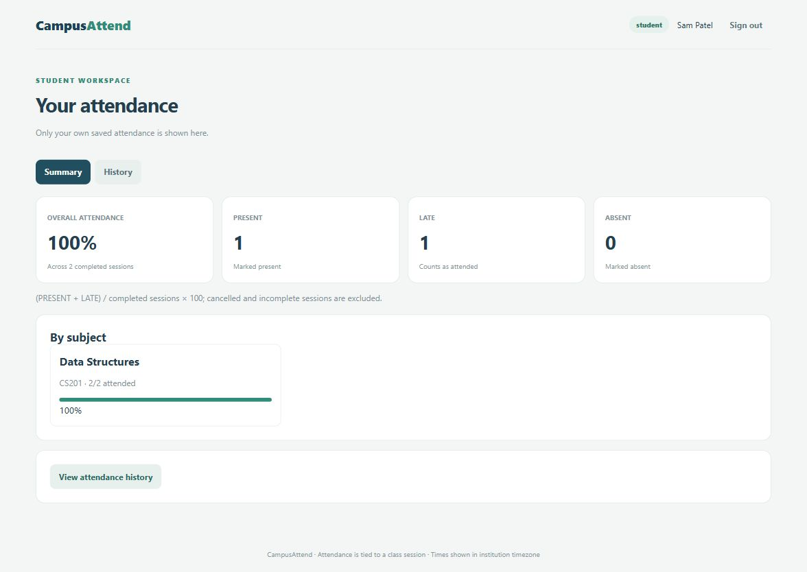

# College Attendance System

A browser application served by Java Spring Boot with persistent MySQL storage. Open **http://localhost:8080**. The frontend is HTML/CSS/JavaScript in `backend/src/main/resources/static/index.html`; all records use the Java API and MySQL.

## Install once on a Windows laptop

1. Install **JDK 21** (not only a JRE). Set `JAVA_HOME` to its folder and add `%JAVA_HOME%\bin` to PATH. Confirm `java -version` and `javac -version`.
2. Install **MySQL Server 8**, including its `mysql` and `mysqldump` command-line tools. Start its Windows service, and retain your administrator password.
3. Use a modern browser. Git is optional: clone this repository or use GitHub **Code → Download ZIP** and extract it.

Maven Wrapper downloads Maven and dependencies on the first run, so internet is required initially. Node, Docker, a separate web server, and a desktop/mobile app are not required.

## First-time database setup

Open the MySQL command-line client as your database administrator:

```powershell
mysql -u root -p
```

Edit `docs/create-database.sql` to replace the placeholder password with a unique local password, then execute those statements in the MySQL client. The account is restricted to the `college_attendance` database. Keep your edited credentials local; do not commit them. Flyway applies the versioned schema automatically when Java starts.

In PowerShell at the repository root:

```powershell
Copy-Item local-config.example.psd1 local-config.psd1
notepad local-config.psd1
```

Set `CAM_DB_PASSWORD` to the database account password you selected. Set host, port and database name if different. `local-config.psd1` is ignored by Git. The example uses MySQL port 3306. On the original development machine the isolated verification database uses port 3307.

## Start and stop

```powershell
.\start-local.ps1
```

If Windows blocks local scripts, run `powershell -ExecutionPolicy Bypass -File .\start-local.ps1` for this one process. The script checks Java and MySQL TCP connectivity, builds/tests with Maven Wrapper, and launches the server. Database authentication and schema checks happen during application startup. Wait for `Started AttendanceApplication`, then visit http://localhost:8080. Keep the terminal open. Press **Ctrl+C** to stop Java; MySQL keeps the saved records.

If port 8080 is occupied, stop your previous instance. For a different port set `PORT` in your environment and open that port instead. MySQL connection errors require checking the running service and local configuration; a TCP connection alone does not prove credentials are valid.

To build without starting:

```powershell
cd backend
.\mvnw.cmd verify
```

## Local development accounts

The `dev` profile seeds these accounts and sample attendance on a fresh database:

| Role | Email | Password |
| --- | --- | --- |
| Admin | admin@college.test | CampusAdmin-Change-123! |
| Faculty | faculty@college.test | FacultyDemo-2026! |
| Student | student@college.test | StudentDemo-2026! |

These are sample accounts for local development. Configuration changes do not reset existing account passwords. Newly created users can change their temporary password from their workspace.

## Workflows

- Admin: create accounts; create departments, academic years, semesters, courses, sections and subjects; enroll students and assign faculty. **Manage records** edits names/codes and activates or deactivates users, courses, sections, subjects, departments, enrollments and assignments. Deactivation retains existing attendance.
- Faculty: select an assigned class, open a dated session, review the entire roster, save attendance, or reopen a saved session to update it. Conflicting edits require reloading.
- Student: view personal percentages and attendance history.
- Admin/faculty: filter reports by date and section and download matching CSV. Faculty are restricted to assigned classes. Each export is limited to 5,000 rows; narrow the date range for larger datasets.

Passwords are BCrypt hashes. Sessions use HttpOnly cookies, requests use CSRF tokens, and backend role/ownership checks enforce access. The local server binds to loopback. Attendance percentage counts PRESENT and LATE over completed recorded sessions; cancelled/open sessions are excluded.

## Backup and transfer

GitHub transfers source code, **not database records**. A fresh laptop starts with a fresh database unless you restore a backup. Avoid changing records during a backup/restore.

```powershell
mysqldump -u attendance -p --single-transaction --no-tablespaces --result-file=attendance.sql.backup college_attendance
mysql -u attendance -p college_attendance
```

At the MySQL prompt on the destination, use `source C:/path/to/attendance.sql.backup;`. Restore into a newly created empty database before starting the application. Restoring into a populated database can replace data; retain a backup first. Do not upload backups containing student data to GitHub.

## Verification and screenshots

See [verification report](docs/verification.md) for actual checks and limitations. The optional integration script requires Python 3 **only for testing** and creates labelled test records in the local demo database:

```powershell
python scripts/verify-local.py
```

The images below are genuine captures of the integrated Java/MySQL application.





