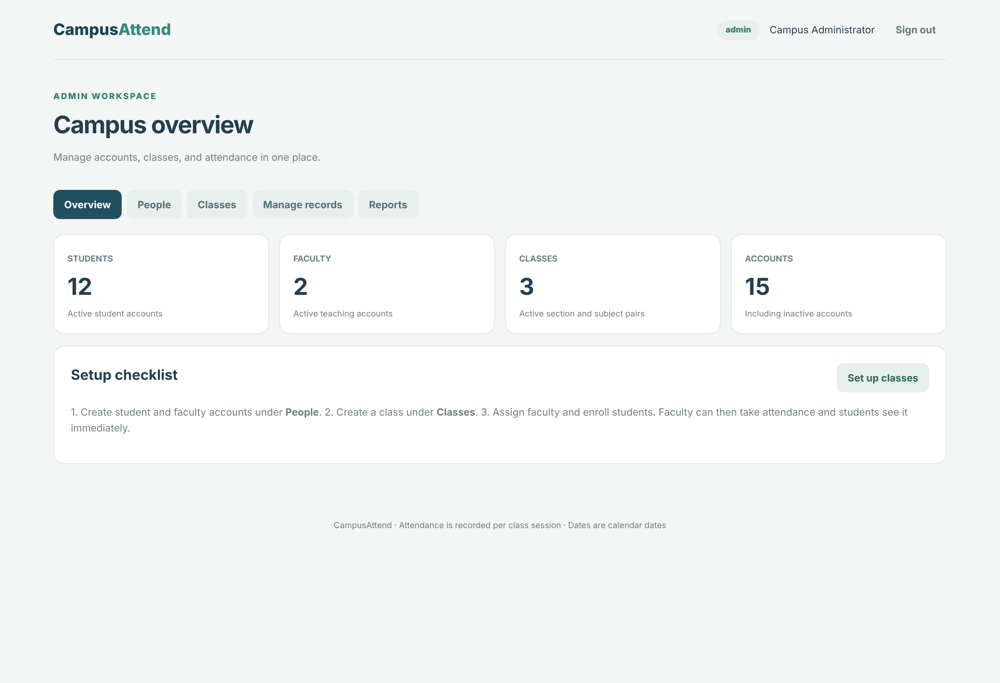

# College Attendance System (CampusAttend)

[](https://github.com/pk7007/college-attendance-system/actions/workflows/build.yml)

A web app for taking and tracking college attendance. It runs on your own computer, opens in any modern browser at **http://localhost:8080**, and stores everything in a MySQL database. Admins, faculty and students each sign in to their own workspace, and anything one person saves is visible to the others straight away.


## Contents

- [What it does](#what-it-does)
- [Install with Docker (recommended)](#install-with-docker-recommended)
- [Install without Docker](#install-without-docker)
- [Demo accounts and sample data](#demo-accounts-and-sample-data)
- [Using it for a real college](#using-it-for-a-real-college)
- [How data stays in sync](#how-data-stays-in-sync)
- [Backups](#backups)
- [Troubleshooting](#troubleshooting)
- [For developers](#for-developers)

---

## What it does

| Role | Can… |
| --- | --- |
| **Admin** | Create student, faculty and admin accounts, reset passwords, and activate or deactivate users. Create departments, academic years, semesters, courses, sections and subjects. Assign faculty to classes and enroll students. Rename or deactivate any record. See reports for every class and download them as CSV. |
| **Faculty** | See their assigned classes with roster sizes. Open a session for a date, mark each student **Present / Absent / Late** (or "Mark all present"), and save. Correct a saved session later, or cancel one that didn't happen. See reports and per-student percentages for their own classes. |
| **Student** | See their overall attendance percentage, Present/Late/Absent counts, a per-subject breakdown, their classes and teachers, and a page-by-page history of every class they were marked in. |

Attendance = *(Present + Late) ÷ completed sessions × 100*. Anything under **75%** is highlighted in red in reports and on the student's own summary. Every new user must replace their temporary password at first sign-in. The pages also work on a phone.

| Admin overview | Faculty taking attendance | Student summary |
| --- | --- | --- |
|  |  |  |

---

## Install with Docker (recommended)

Docker sets up Java and MySQL for you, so this is the easiest way on **Windows, macOS or Linux**.

1. **Install Docker Desktop** from <https://www.docker.com/products/docker-desktop/> and open it. Wait until it shows that Docker is running.
   - **Windows:** Docker Desktop uses WSL 2. If the installer asks, let it install or enable WSL 2 and restart. Virtualization must be on in the BIOS; it usually is.
   - **Linux:** install Docker Engine and the Docker Compose plugin instead.
2. **Get the code**, either with Git:
   ```bash
   git clone https://github.com/pk7007/college-attendance-system.git
   ```
   or on GitHub with **Code → Download ZIP**, then unzip it.
3. **Open a terminal in the project folder**, the one containing `docker-compose.yml`. On Windows use PowerShell or Command Prompt.
   ```bash
   cd college-attendance-system
   ```
4. **Optional: choose your own passwords.** Copy `.env.example` to `.env` and edit it. If you skip this, the demo defaults are used.
5. **Start it:**
   ```bash
   docker compose up -d --build
   ```
   The first start downloads and builds everything, which takes a few minutes. Later starts take seconds.
6. **Open <http://localhost:8080>** and sign in with one of the [demo accounts](#demo-accounts-and-sample-data).

| To… | Run |
| --- | --- |
| Stop (your data is kept) | `docker compose down` |
| Start again | `docker compose up -d` |
| Update to the latest code | `git pull`, then `docker compose up -d --build` |
| See the server log | `docker compose logs -f app` |
| Check what is running | `docker compose ps` |
| Delete **all** data and start fresh (reloads the sample data) | `docker compose down -v`, then `docker compose up -d` |

---

## Install without Docker

You need **JDK 21** (not just a JRE) and **MySQL Server 8**. The first run needs internet, because it downloads Maven and the app's libraries.

### 1. Create the database (once)

Open the MySQL client as the administrator (`mysql -u root -p`). Edit [`docs/create-database.sql`](docs/create-database.sql) to replace the placeholder password with one you choose, then run its statements. The tables are created automatically when the app starts.

### 2a. Windows

In PowerShell, in the project folder:

```powershell
Copy-Item local-config.example.psd1 local-config.psd1
notepad local-config.psd1
```

Set `CAM_DB_PASSWORD` to the password from step 1, save, then start:

```powershell
.\start-local.ps1
```

If Windows blocks the script, run `powershell -ExecutionPolicy Bypass -File .\start-local.ps1` instead.

### 2b. macOS / Linux

```bash
cp local-config.example.env local-config.env
nano local-config.env
```

Set `CAM_DB_PASSWORD` (keep the single quotes), save, then start:

```bash
./start-local.sh
```

Both scripts check Java and MySQL, build and test the app, then start it. Wait for `Started AttendanceApplication`, open <http://localhost:8080>, and keep the terminal open. **Ctrl+C** stops the server; MySQL keeps the records. Your `local-config.*` file is ignored by Git, so your password is never uploaded.

---

## Demo accounts and sample data

With the default `dev` profile, a fresh database gets about **a month of sample attendance**. The sample uses one section, `CS-2A` (B.Sc. Computer Science), in the current semester:

- **3 subjects:**
  - CS201 Data Structures (Mon/Wed/Fri) and CS202 Database Systems (Tue/Thu), taught by Jordan Lee.
  - CS203 Operating Systems (Mon/Thu), taught by Anita Rao.
- **12 students**, with marks for every class from the last 30 days up to yesterday. Most attend well and a few fall below 75%, so the reports show realistic variety.
- **One cancelled class**, which is excluded from every total.
- **Today's class is left open**, so you can take today's attendance yourself as faculty.

If the current semester started less than 30 days ago, the sample begins at the semester start. The sample is only added to an **empty** database; with Docker, run `docker compose down -v` then `docker compose up -d` to reload it (this deletes all data).

| Role | Email | Password |
| --- | --- | --- |
| Admin | admin@college.test | CampusAdmin-Change-123! |
| Faculty | faculty@college.test (Jordan Lee) · faculty2@college.test (Anita Rao) | FacultyDemo-2026! |
| Student | student@college.test (Sam Patel) · student2@college.test … student12@college.test | StudentDemo-2026! |

**Try it:** sign in as faculty in one browser window and as a student in a private window. As faculty, open today's session, mark the student Absent and save. Then refresh the student's page: their percentage drops straight away. The admin's **Reports** tab shows the same number.

---

## Using it for a real college

1. **Before the first start**, set these in `.env` (Docker) or your `local-config` file:
   - `SPRING_PROFILES_ACTIVE=prod`, so no sample data is created.
   - Your own admin email (`CAM_BOOTSTRAP_ADMIN_EMAIL`) and a `CAM_BOOTSTRAP_ADMIN_PASSWORD` of 12+ characters. In `prod`, the admin must choose a private password at first sign-in.
   - New database passwords. MySQL keeps the first ones it sees, so changing them later is harder.
2. Sign in as the admin. Under **People**, create faculty and student accounts, each with a temporary password. Every user picks their own password at first sign-in.
3. Under **Classes**, create a class. The form suggests the current academic year (June–May) and semester (Jun–Nov or Dec–May); change the dates to match your college. Then assign faculty and enroll students.
4. Faculty use **Take attendance**: pick the class, check the date, **Open session**, mark students, **Save attendance**.
5. When a semester ends, create the next one under **Classes**, and deactivate old sections under **Manage records**. Their attendance history stays in the reports.

**Network use:** to let other computers on your network connect (Docker), set `CAM_BIND=0.0.0.0` in `.env` and open `http://<this-computer's-IP>:8080` from them. Set `TZ` (for example `Asia/Kolkata`) so "today" matches your local date. The app uses plain HTTP, so put it behind HTTPS before exposing it to the internet.

---

## How data stays in sync

All three roles read the same database tables, so there is no copy to get out of date:

- **Saved attendance** shows up immediately in the student's summary and history, and in admin and faculty reports. They all use the same formula.
- **Correcting a mark** changes every view. If two faculty members edit the same session at once, the second save is refused with "Someone else saved this session" and the page reloads the current marks, instead of silently overwriting them.
- **Cancelling a session** removes it from every total. Opening a session with the same date and label reopens it.
- **Deactivating** a department, semester, course, section, subject or faculty assignment under **Manage records** hides that class from admin, faculty and student class lists, and faculty can no longer take attendance for it. Saved attendance history is kept. Re-activating it, or re-entering the same codes in **Classes**, brings it back.
- **Deactivating a user** signs them out on their next click and removes them from rosters. **Enrolling or assigning again** reactivates an earlier enrollment or assignment.
- **Resetting a password** (People page) makes the user choose a new one before they can do anything else, and lifts any sign-in block from failed attempts.

Automated tests cover these rules. They sign in an admin, faculty and students at the same time against a real MySQL database (see [For developers](#for-developers)).

---

## Backups

GitHub stores the **code, not the attendance records**. Back up the database regularly, and never upload backups: they contain student data.

```bash
# Docker: back up, and restore into an empty database
docker compose exec db sh -c 'mysqldump -u attendance -p"$MYSQL_PASSWORD" --single-transaction --no-tablespaces college_attendance' > attendance-backup.sql
docker compose exec -T db sh -c 'mysql -u attendance -p"$MYSQL_PASSWORD" college_attendance' < attendance-backup.sql
```

```powershell
# Without Docker (Windows, macOS, Linux): back up
mysqldump -u attendance -p --single-transaction --no-tablespaces --result-file=attendance-backup.sql college_attendance
# ...and restore into an empty college_attendance database (create it with docs/create-database.sql first)
mysql -u attendance -p college_attendance -e "source attendance-backup.sql"
```

---

## Troubleshooting

| Problem | Fix |
| --- | --- |
| `Cannot connect to the Docker daemon` / `error during connect` | Docker Desktop isn't running. Open it, wait until it says it is running, then try again. |
| `docker: command not found` / `'docker' is not recognized` | Install Docker Desktop (see step 1), then open a **new** terminal. |
| Windows: Docker Desktop asks for WSL 2 or virtualization | Accept the WSL 2 install and restart. If it says virtualization is disabled, turn on "Intel VT-x" or "AMD-V/SVM" in the BIOS. |
| `port is already allocated` or 8080 in use | Stop the other program, or set `CAM_PORT=8081` in `.env` (Docker) or `PORT=8081` (start scripts) and open that port. |
| "Cannot reach the server" in the browser | The app isn't running. Check `docker compose ps` and `docker compose logs app`, or the terminal running the start script. |
| Can't sign in as admin on a new database | Make sure `CAM_BOOTSTRAP_ADMIN_EMAIL` and `CAM_BOOTSTRAP_ADMIN_PASSWORD` (12+ characters) are set, then restart. Existing accounts are never overwritten. |
| No sample data appears | It's only added to an empty database with the `dev` profile. Run `docker compose down -v`, then `docker compose up -d`. |
| "Too many failed sign-in attempts" | Wait 15 minutes, or have an admin reset the password. |
| "Session date must be within the semester" | The semester has ended. Create the next semester under **Classes**. |
| Changed the DB password in `.env` but MySQL rejects it | MySQL keeps the first password. Use the old one, or run `docker compose down -v` to wipe and start over. |

---

## For developers

**Stack:** Spring Boot 3.5 (Java 21) with JDBC and Flyway, and MySQL 8. The whole UI is one HTML/CSS/JavaScript page with no build step. See [architecture](docs/architecture.md) for the design and the rules that keep roles consistent.

```
backend/
  src/main/java/edu/college/attendance/   controllers (Admin, Faculty, Student, Reports, Management, Auth),
                                          SecurityConfig, AppSupport (shared "live class" rule), DevelopmentBootstrap (startup/sample data)
  src/main/resources/static/index.html    the entire web interface
  src/main/resources/db/migration/        Flyway SQL migrations (add V2__..., never edit applied ones)
  src/test/java/...                       unit tests and multi-user MySQL integration tests
docker-compose.yml, Dockerfile, .env.example     Docker install
start-local.ps1 / start-local.sh                  install without Docker (Windows / macOS, Linux)
scripts/verify-local.py                           smoke test against a running dev server
docs/                                             architecture, verification report, database setup, screenshots
```

**Tests:**
- `cd backend && ./mvnw verify` (or `mvnw.cmd verify` on Windows) runs the 8 unit tests.
- The 12 multi-user integration tests run only when pointed at a **throwaway** MySQL database, which they wipe:
  ```bash
  CAM_IT_DB_URL='jdbc:mysql://127.0.0.1:3306/cams_it' CAM_IT_DB_USER=root CAM_IT_DB_PASSWORD=... ./mvnw verify
  ```
- GitHub Actions runs all 20 tests against MySQL 8.4 and builds the Docker image on every push. The badge at the top shows the result for `main`.
- `python scripts/verify-local.py` is an extra smoke test against a running dev server. It adds labelled test records.
- See the [verification report](docs/verification.md) for exactly what was checked and what wasn't.
