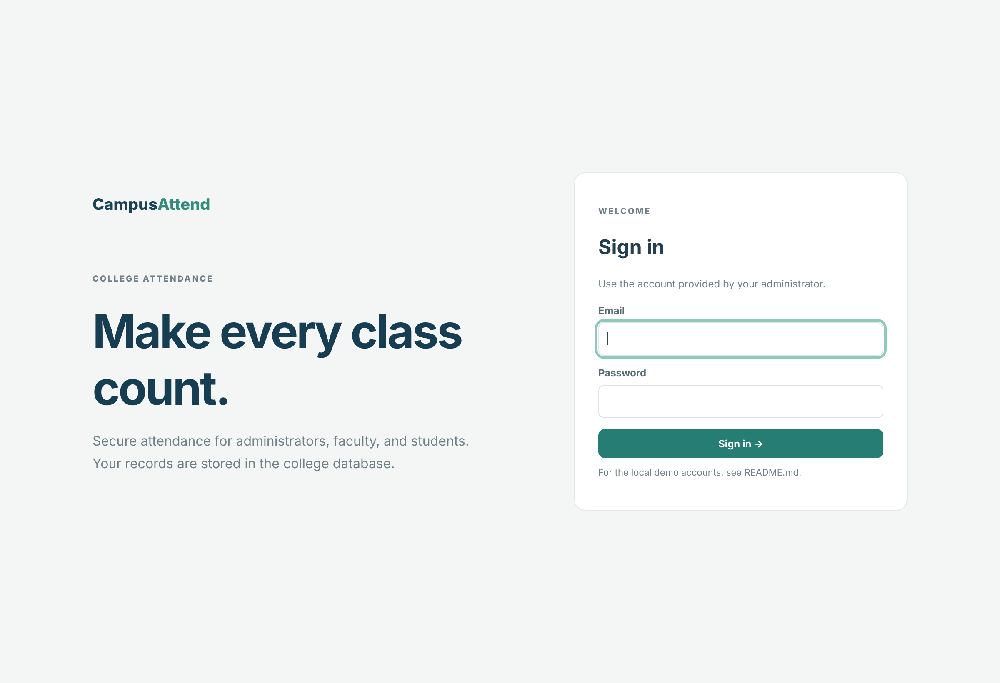
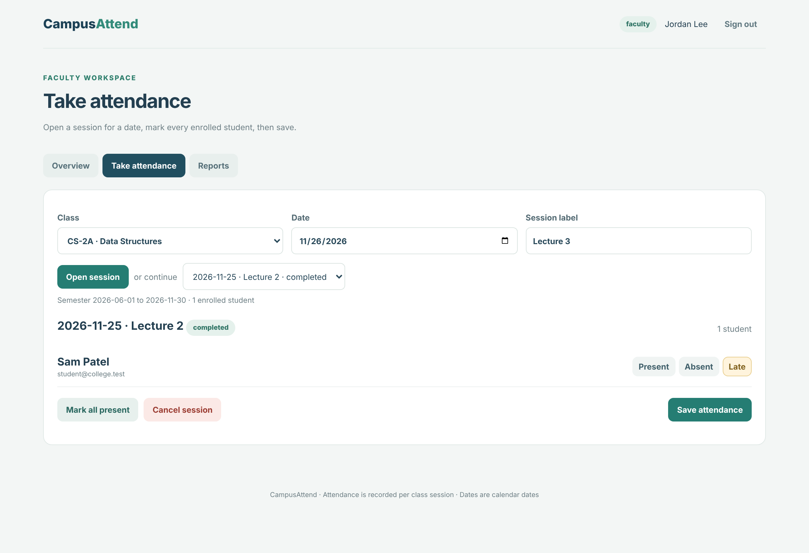
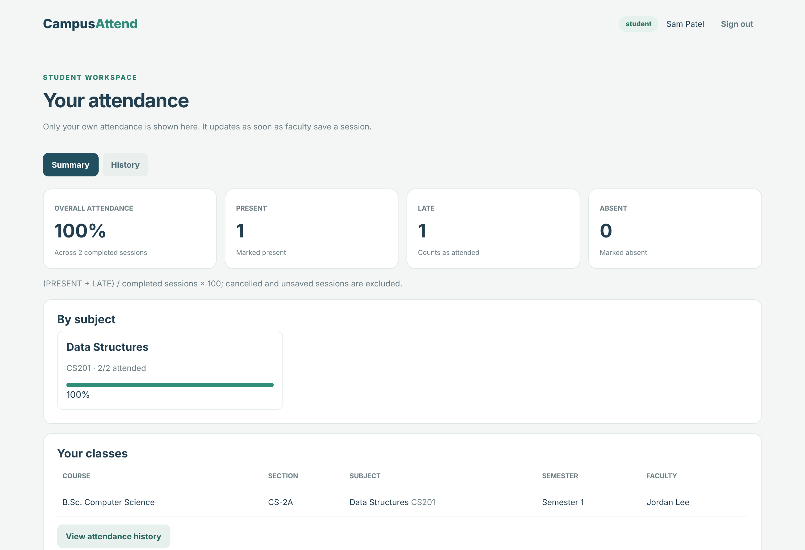

# College Attendance System (CampusAttend)

A web app for taking and tracking college attendance, with three kinds of accounts:

- **Admin**: creates accounts, classes and subjects, enrolls students, assigns faculty, and sees every report.
- **Faculty**: opens a class session, marks each student Present / Absent / Late, and sees reports for their own classes.
- **Student**: sees their own attendance percentage, per-subject breakdown, classes and history.

Everything one person saves is visible to the others straight away (see [How data stays in sync](#how-data-stays-in-sync)). It runs as one Java (Spring Boot) server with a MySQL database and opens in any modern browser at **http://localhost:8080**.

---

## Install with Docker (recommended, any computer)

This is the easiest way: Docker sets up Java and MySQL for you.

1. **Install Docker Desktop** from <https://www.docker.com/products/docker-desktop/> and start it. On Linux, install Docker Engine with the Compose plugin.
2. **Get the code**, either with Git:
   ```bash
   git clone https://github.com/pk7007/college-attendance-system.git
   ```
   or on GitHub with **Code → Download ZIP**, then unzip it.
3. **Open a terminal in the project folder** (the one containing `docker-compose.yml`):
   ```bash
   cd college-attendance-system
   ```
4. **Optional: choose your own passwords.** Copy `.env.example` to `.env` and edit it. If you skip this, the demo defaults are used.
5. **Start it:**
   ```bash
   docker compose up -d --build
   ```
   The first start downloads and builds everything and takes a few minutes. Later starts take seconds.
6. **Open <http://localhost:8080>** and sign in with one of the [demo accounts](#demo-accounts).

| To… | Run |
| --- | --- |
| Stop (your data is kept) | `docker compose down` |
| Start again | `docker compose up -d` |
| Update after pulling new code | `git pull` then `docker compose up -d --build` |
| See the server log | `docker compose logs -f app` |
| Delete **all** data and start fresh | `docker compose down -v` |

---

## Install without Docker

You need **JDK 21** (not just a JRE) and **MySQL Server 8**. Maven downloads itself on the first build, so the first run needs internet.

### 1. Create the database (once)

Open the MySQL client as the administrator (`mysql -u root -p`). Edit [`docs/create-database.sql`](docs/create-database.sql) to replace the placeholder password with one you choose, then run its statements. The tables are created automatically when the app starts.

### 2a. Windows

In PowerShell, in the project folder:

```powershell
Copy-Item local-config.example.psd1 local-config.psd1
notepad local-config.psd1
```

Set `CAM_DB_PASSWORD` to the password from step 1, save, then start:

```powershell
.\start-local.ps1
```

If Windows blocks the script, run `powershell -ExecutionPolicy Bypass -File .\start-local.ps1` instead.

### 2b. macOS / Linux

```bash
cp local-config.example.env local-config.env
nano local-config.env
```

Set `CAM_DB_PASSWORD`, save, then start:

```bash
./start-local.sh
```

Both scripts check Java and MySQL, build and test the app, then start it. Wait for `Started AttendanceApplication`, open <http://localhost:8080>, and keep the terminal open. **Ctrl+C** stops the server; MySQL keeps the records. Your `local-config.*` file is ignored by Git, so your password is never uploaded.

---

## Demo accounts

With the default `dev` profile, a fresh database gets about **a month of sample attendance**. The demo has one section, `CS-2A` (B.Sc. Computer Science), in the current semester:

- **3 subjects:** CS201 Data Structures (Mon/Wed/Fri) and CS202 Database Systems (Tue/Thu), taught by Jordan Lee; and CS203 Operating Systems (Mon/Thu), taught by Anita Rao.
- **12 students**, with marks for every class in the last 30 days up to yesterday. Most students attend well and a few fall below 75%, so reports show realistic variety. Attendance under 75% is highlighted in red.
- **One cancelled class**, which is excluded from every total.
- **Today's class is left open**, so faculty can take today's attendance themselves.

If the current semester started less than 30 days ago, the sample begins at the semester start.

| Role | Email | Password |
| --- | --- | --- |
| Admin | admin@college.test | CampusAdmin-Change-123! |
| Faculty | faculty@college.test (Jordan Lee), faculty2@college.test (Anita Rao) | FacultyDemo-2026! |
| Student | student@college.test (Sam Patel), student2@college.test … student12@college.test | StudentDemo-2026! |

The sample is only added to an **empty** database. To reload it on an existing Docker install, run `docker compose down -v` (this deletes all data) and then `docker compose up -d`.

**Try it:** sign in as faculty in one browser window and as the student in a private window. Save attendance as faculty, then refresh the student page: the new percentage appears straight away.

## Using it for a real college

1. In `.env` (Docker) or your `local-config` file, set `SPRING_PROFILES_ACTIVE=prod` so no demo data is created. Set your own admin email and a `CAM_BOOTSTRAP_ADMIN_PASSWORD` (12+ characters), and change the database passwords **before the first start**. In `prod` the admin is asked to choose a private password at first sign-in.
2. Sign in as the admin. Under **People**, create faculty and student accounts with a temporary password each. Every new user must choose their own password at first sign-in.
3. Under **Classes**, create a class. The form suggests the current academic year (June–May) and semester (Jun–Nov or Dec–May); change the dates to match your college. Then assign faculty and enroll students.
4. Faculty use **Take attendance**: pick the class, check the date, **Open session**, mark students, **Save attendance**.

To let other computers on your network use it with Docker, set `CAM_BIND=0.0.0.0` in `.env` and open `http://<this-computer's-IP>:8080`. The app uses plain HTTP, so put it behind HTTPS before exposing it to the internet.

## How data stays in sync

All three roles read the same database tables, so there is no copy to get out of date:

- **Saved attendance** shows up immediately in the student's summary and history, and in admin and faculty reports. All of them use the same formula: *(Present + Late) ÷ completed sessions × 100*.
- **Correcting a mark** changes every view. If two faculty members edit the same session at once, the second save is refused with "Someone else saved this session" instead of silently overwriting.
- **Cancelling a session** removes it from every total. Opening a session with the same date and label reopens it.
- **Deactivating** a department, semester, course, section, subject or faculty assignment under **Manage records** hides that class from admin, faculty and student class lists. Faculty can no longer take attendance for it, and saved attendance history is kept. Re-activating it, or re-entering the same codes in **Classes**, brings it back.
- **Deactivating a user** signs them out on their next click and removes them from rosters. **Enrolling or assigning again** reactivates an earlier enrollment or assignment.
- **Resetting a password** (People page) makes the user choose a new one before they can do anything else.

These rules are covered by automated tests that sign in as an admin, faculty and students at the same time against a real MySQL database (see below).

## Backups

GitHub stores the **code, not the attendance records**. Back up the database regularly and never upload backups (they contain student data).

```bash
# Docker: back up, and restore into an empty database
docker compose exec db sh -c 'mysqldump -u attendance -p"$MYSQL_PASSWORD" --single-transaction --no-tablespaces college_attendance' > attendance-backup.sql
docker compose exec -T db sh -c 'mysql -u attendance -p"$MYSQL_PASSWORD" college_attendance' < attendance-backup.sql
```

```powershell
# Without Docker (Windows, macOS, Linux): back up
mysqldump -u attendance -p --single-transaction --no-tablespaces --result-file=attendance-backup.sql college_attendance
# ...and restore into an empty college_attendance database (create it with docs/create-database.sql first)
mysql -u attendance -p college_attendance -e "source attendance-backup.sql"
```

## Troubleshooting

| Problem | Fix |
| --- | --- |
| `port is already allocated` or 8080 in use | Stop the other program, or set `CAM_PORT=8081` in `.env` (Docker) / `PORT=8081` (scripts) and open that port. |
| "Cannot reach the server" in the browser | The app is not running. Check `docker compose ps`, or the terminal running the start script. |
| Can't sign in as admin on a new database | Make sure `CAM_BOOTSTRAP_ADMIN_EMAIL` / `CAM_BOOTSTRAP_ADMIN_PASSWORD` are set (12+ characters) and restart. Existing accounts are never overwritten. |
| "Too many failed sign-in attempts" | Wait 15 minutes, or have an admin reset the password. |
| "Session date must be within the semester" | The semester's dates have ended. Create the next semester under **Classes**. |
| Changed DB password in `.env` but MySQL rejects it | MySQL keeps the first password. Use the old one, or `docker compose down -v` to wipe and start over. |

## For developers

- Code: `backend/` (Spring Boot 3.5, Java 21, JDBC, Flyway). The whole UI is `backend/src/main/resources/static/index.html`. See [architecture](docs/architecture.md).
- `cd backend && ./mvnw verify` runs the unit tests. To also run the multi-user integration tests, point them at a **throwaway** MySQL database (it is wiped):
  ```bash
  CAM_IT_DB_URL='jdbc:mysql://127.0.0.1:3306/cams_it' CAM_IT_DB_USER=root CAM_IT_DB_PASSWORD=... ./mvnw verify
  ```
- GitHub Actions runs those integration tests against MySQL 8.4 and builds the Docker image on every push.
- `python scripts/verify-local.py` is an extra smoke test against a running dev server (it adds labelled test records).
- See the [verification report](docs/verification.md) for what was checked and how.





